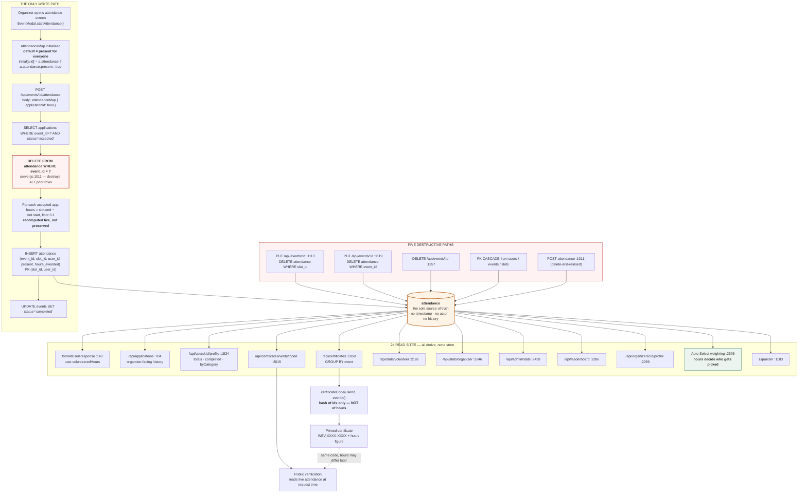

# Block 2 — Attendance & Hours Pipeline Analysis

**Date:** 2026-07-21
**Status:** Analysis only. No code modified. Awaiting approval before implementation.
**Governing constraint:** *Existing volunteer records must not change.* Every design decision below is subordinate to that.

---

## 0. Verified facts

Established by probing a copy of the live database, not by reading code:

| Fact | Value | Why it matters |
|---|---|---|
| `PRAGMA foreign_keys` | **1 (ON)** | `node:sqlite` enables FK enforcement by default — unlike `better-sqlite3`, which defaults OFF. `ON DELETE CASCADE` is **live**. Deleting a user or event genuinely destroys attendance rows. |
| `PRAGMA journal_mode` | `delete` | Not WAL. A file copy during a write is not guaranteed consistent — affects the backup design in 1.18. |
| `attendance` rows | 12 | Small enough that migration is trivially verifiable by hand. |
| Writers to `attendance` | **1** (`POST /api/events/:id/attendance`) + seed | Single write path. This is the pipeline's one genuine strength. |
| Readers of `hours_awarded` | **24 call sites** across 13 endpoints | Any change to storage semantics has a wide blast radius. |

**Baseline that must survive Block 2 byte-for-byte:**

| Volunteer | Credited hours |
|---|---|
| Priya Patel | 5 |
| Leo Chen, Arjun Gopal, Alexis Brennan, Cameron Caldwell, Derek Sorensen, Dana Sorensen, Marcus Pelletier, Nora Caldwell, Priyanka Shah | 2 each |

---

## 1. Current data flow: attendance → hours → certificates



**Narrative.** Hours exist in exactly one place: `attendance` rows where `present = 1`. Nothing is stored on the user. Every one of the 24 read sites re-derives from that table. That design is *correct* and is why the hours figure agrees with itself everywhere in the product — the invariant is worth protecting, not replacing.

The weakness is entirely on the write side. There is one writer, and it is implemented as **delete-everything-then-reinsert**, against a table with **no timestamp, no actor, and no history**. The table cannot distinguish "this student was marked absent" from "this row was never written" from "this row was destroyed by an unrelated edit." Once a row is gone, nothing in the system knows it existed.

Two structural notes that shape the fix:

- `hours_awarded` is retained on rows with `present = 0` (seed row `user-student-3` carries `present=0, hours_awarded=3`). The column means *"what this shift was worth"*; `present` gates whether it counts. The ledger must preserve that distinction rather than collapsing absence to zero.
- The attendance PK is `(slot_id, user_id)`, but the API keys its input map by **application id**. These are different identity spaces. An application deleted and recreated gets a new id while the attendance PK is unchanged — the map key silently stops matching.

---

## 2. Every way hours can currently be lost or corrupted

Ordered by likelihood of occurring in a real school deployment.

---

### L1 — Re-taking attendance silently zeroes anyone no longer `accepted`
**Severity: critical · Likelihood: high**

`POST /api/events/:id/attendance` deletes every attendance row for the event, then re-inserts only for applications currently in status `accepted` ([server.js:1005-1030](server/server.js:1005)).

A student marked present, whose application is later set to `waitlisted` or `rejected` for any reason, loses their credited hours the next time the organizer touches that screen. No warning, no trace, and the student's total silently drops.

---

### L2 — Default-present over-credits multi-day events
**Severity: critical · Likelihood: high**

`startAttendance()` initialises every accepted application without an existing record to **`true`** ([EventModal.jsx:109](src/components/EventModal.jsx:109)).

On a five-Saturday event, every volunteer for all five Saturdays is `accepted` from the outset. After Saturday 1 the organizer opens the screen, sees everyone pre-ticked, and saves — **crediting hours to four Saturdays' worth of volunteers who have not yet attended.** Combined with L5 (no end-time check) there is nothing to stop it. The button even reads "Credit hours to 40 volunteers."

This is the fastest path to hours in the system being provably wrong.

---

### L3 — Editing an event destroys attendance for removed shifts
**Severity: critical · Likelihood: medium**

[server.js:1113](server/server.js:1113) deletes attendance for any slot absent from the payload. [server.js:1119](server/server.js:1119) is worse: when the payload contains no persisted slot ids, it deletes **every** application and attendance row for the event.

An organizer tidying up a finished event's shift list destroys the hours that event produced. There is no confirmation naming the affected volunteers, and no server-side refusal.

---

### L4 — Re-taking attendance retroactively re-prices completed service
**Severity: high · Likelihood: medium**

`hours_awarded` is recomputed from the slot's *current* start/end times on every save ([server.js:1019-1024](server/server.js:1019)). It is not preserved from the original credit.

Sequence: student works a 3-hour shift → credited 3.0 → organizer later corrects the slot's end time to reflect the real schedule → re-opens attendance for an unrelated fix → **every historical credit for that slot silently re-prices.** The certificate the student already printed now disagrees with the platform.

---

### L5 — Attendance can be credited before the shift has happened
**Severity: high · Likelihood: medium**

No check that `slot.end_datetime` has passed. Combined with L2, an organizer can credit an entire multi-week event on day one.

---

### L6 — Stale or partial `attendanceMap` marks people absent
**Severity: high · Likelihood: medium**

Any accepted application missing from the submitted map is written as `present = 0`, because `!!attendanceMap[app.id]` treats `undefined` as false ([server.js:1013](server/server.js:1013)).

Realistic trigger: the organizer opens the attendance screen; a waitlist promotion fires while it is open; they save. The promoted volunteer — accepted, and possibly having actually attended — is recorded absent. Any direct API call with a partial map does the same.

---

### L7 — FK CASCADE destroys hours when a user or event is deleted
**Severity: critical · Likelihood: low (but unrecoverable)**

Verified live: FK enforcement is **on**, so deleting a user removes their attendance rows outright. Block 1 closed the `deny` route into this, but `DELETE /api/events/:id` (available to the organizer *and* any admin) still cascades away every hour that event ever credited.

There is no soft-delete and no backup. This is not recoverable.

---

### L8 — Certificates are not immutable and their code does not bind the hours
**Severity: high · Likelihood: certain once any of L1–L6 occurs**

`certificateCode(userId, eventId)` hashes **only the two ids** ([server.js:1996](server/server.js:1996)). The public verifier re-derives hours from live attendance at request time ([server.js:2015](server/server.js:2015)).

A certificate printed at 6 hours and later affected by any loss path above still presents a *valid* code — which now verifies at a different number. The document a college or district office is holding is contradicted by the platform, and the code gives no way to detect that it changed.

---

### L9 — Corrupted hours silently corrupt future Auto Select fairness
**Severity: high · Likelihood: follows from any of the above**

Selection weight is `W(h) = 1.5 + 8.5 / (1 + 0.005h)` computed from live totals ([server.js:2595](server/server.js:2595)). A student whose hours were wrongly erased is treated as a newcomer and gets a *higher* selection probability; one wrongly over-credited is pushed down. **Hours loss does not merely misreport the past — it distributes future opportunities unfairly**, and leaves no evidence of why.

---

### L10 — No transaction around the attendance rewrite
**Severity: medium · Likelihood: low**

The delete and the re-inserts at [server.js:1005-1035](server/server.js:1005) run outside `inTransaction()`. A crash or constraint failure mid-loop leaves the event with attendance partially deleted and partially rewritten.

---

### L11 — No audit trail at all
**Severity: critical (as an amplifier) · Likelihood: certain**

`attendance` has no `created_at`, no `updated_at`, no actor. When a parent asks *"my daughter had 12 hours in March, why does it say 6?"*, there is **no query that can answer**. Every failure above is not just a loss but an *undetectable, unattributable* loss. This is what makes the hours ledger the centrepiece of Block 2 rather than a nice-to-have.

---

## 3. Proposed schema: `hours_ledger`

### Design decision — and the reason it is this way

Two options were considered:

| | Ledger as source of truth | **Ledger alongside `attendance` (proposed)** |
|---|---|---|
| Hours derived from | `SUM(ledger.delta)` | `SUM(attendance.hours_awarded WHERE present=1)` — unchanged |
| Read sites to rewrite | **24** | **0** |
| Risk to existing totals | Real — any query error changes a student's record | **None — no existing read path is touched** |
| Architectural purity | Higher | Lower |

**Proposed: the second.** `attendance` stays the source of truth; the ledger is an append-only record of every change made to it. This is the only option that satisfies *"existing volunteer records must not change"* by construction rather than by careful testing — the 24 queries producing today's numbers are not modified at all, so they cannot produce different numbers.

The purer design is a reasonable future step once the ledger has accumulated real history and can be reconciled against `attendance` over time. It should not be attempted in the same change as the fix.

### Schema

```sql
CREATE TABLE IF NOT EXISTS hours_ledger (
  id            TEXT PRIMARY KEY,

  -- What record changed
  user_id       TEXT NOT NULL,
  event_id      TEXT NOT NULL,
  slot_id       TEXT NOT NULL,

  -- Denormalised snapshots. The ledger must stay readable after the thing it
  -- describes is deleted — that is the entire point of an audit log.
  user_name     TEXT,
  event_title   TEXT,
  slot_name     TEXT,

  -- The change itself. before-values are NULL when no prior row existed.
  action          TEXT NOT NULL CHECK(action IN
                    ('credited','revoked','adjusted','migrated','voided')),
  present_before  INTEGER CHECK(present_before IN (0,1)),
  present_after   INTEGER CHECK(present_after  IN (0,1)),
  hours_before    REAL,
  hours_after     REAL,
  -- Effective change to this user's credited total. Absence is a zero-delta
  -- event, not a missing one: hours_awarded is retained when present = 0.
  delta           REAL NOT NULL,

  -- Attribution
  actor_id      TEXT,
  actor_role    TEXT CHECK(actor_role IN ('organizer','admin','system',NULL)),
  source        TEXT NOT NULL CHECK(source IN
                  ('attendance_screen','event_edit','event_delete',
                   'migration','admin_correction')),
  reason        TEXT,

  created_at    TEXT NOT NULL
);

CREATE INDEX IF NOT EXISTS idx_ledger_user  ON hours_ledger(user_id, created_at);
CREATE INDEX IF NOT EXISTS idx_ledger_event ON hours_ledger(event_id, created_at);
CREATE INDEX IF NOT EXISTS idx_ledger_slot  ON hours_ledger(slot_id, user_id);
```

### Deliberate omissions, each with a reason

- **No foreign keys.** Every other table in the schema uses `ON DELETE CASCADE`, and FK enforcement is verified ON. An audit log with a cascading FK deletes itself exactly when it is needed — when the user or event is removed. Referential integrity is traded for survivability, which is the correct trade for this table alone. The denormalised name columns are what make an orphaned row still meaningful.
- **No `UPDATE` or `DELETE` in application code.** Append-only is enforced by convention plus code review now; a trigger rejecting `UPDATE`/`DELETE` is worth adding once the table is in use.
- **No `application_id`.** Deliberately keyed on `(slot_id, user_id)` to match the `attendance` primary key, sidestepping the identity-space mismatch described in §1.

---

## 4. Migration strategy

**Governing rule: the migration never writes to `attendance`.** It is additive only. If it fails at any point, `attendance` is byte-identical and the application continues working.

### Step 0 — Backup and baseline
```bash
sqlite3 server/wevolunteer.db ".backup /safe/pre-ledger-$(date +%s).db"
```
`.backup` rather than `cp`, because `journal_mode = delete` means a file copy taken during a write is not guaranteed consistent.

Capture the authoritative baseline to a file:
```sql
SELECT user_id, ROUND(SUM(hours_awarded), 4) AS hours
FROM attendance WHERE present = 1 GROUP BY user_id ORDER BY user_id;
```

### Step 1 — Create the table
`CREATE TABLE IF NOT EXISTS` in `initDatabase()`, following the existing `addColumnIfMissing` convention. Idempotent, no data touched.

### Step 2 — Idempotent backfill
One `migrated` entry per existing attendance row, with a **deterministic id** so re-running is a no-op:

```
id           = 'migrate:' || slot_id || ':' || user_id
action       = 'migrated'
present_before = NULL          -- no prior state is knowable
hours_before   = NULL
present_after  = attendance.present
hours_after    = attendance.hours_awarded
delta          = CASE WHEN present = 1 THEN hours_awarded ELSE 0 END
actor_id       = NULL
actor_role     = 'system'
source         = 'migration'
reason         = 'Backfilled from attendance at ledger introduction. Prior
                  history was not recorded and is not reconstructable.'
created_at     = <migration timestamp>
```

`INSERT OR IGNORE` on the deterministic PK makes reruns safe.

**The migration must not invent history.** Before-values are `NULL` and `created_at` is the migration time, not a guessed event date. A ledger that fabricates plausible-looking history is worse than one that honestly says "history begins here" — the whole value of the table is that it can be trusted.

### Step 3 — Verification gate (blocking)
```sql
-- Must return zero rows. Any output aborts the migration.
SELECT l.user_id, l.ledger_total, a.attendance_total
FROM (SELECT user_id, ROUND(SUM(delta),4) ledger_total
      FROM hours_ledger GROUP BY user_id) l
FULL OUTER JOIN
     (SELECT user_id, ROUND(SUM(hours_awarded),4) attendance_total
      FROM attendance WHERE present = 1 GROUP BY user_id) a
  ON l.user_id = a.user_id
WHERE COALESCE(l.ledger_total,0) != COALESCE(a.attendance_total,0);
```
(SQLite lacks `FULL OUTER JOIN` before 3.39 — implement as two `LEFT JOIN`s unioned, or verify in JS.)

Then re-run the Step 0 baseline query and diff against the saved file. **Byte-identical, or roll back.**

### Step 4 — Enable ledger writes
Only after Steps 1–3 pass. Every write path gains a ledger entry inside the same `inTransaction()` as the `attendance` mutation, so the two can never diverge.

### Rollback
`DROP TABLE hours_ledger`. Because nothing else reads it and `attendance` was never written, rollback is total and instant.

### Compatibility notes
- **No existing endpoint changes shape.** The ledger adds no fields to any current response.
- **The 12 production-relevant rows are hand-verifiable** — small enough to eyeball the entire backfill.
- **`node:sqlite` has no `.transaction()`** (per project convention); use the existing `inTransaction()` helper.
- The `migrated` entries are permanently distinguishable via `source = 'migration'`, so any future analysis can exclude reconstructed history from observed history.

---

## 5. Testing plan

### Tier 0 — The backwards-compatibility gate (must exist before any other change)

A golden-snapshot test, run before and after every commit in Block 2:

```
snapshot = { user_id → SUM(hours_awarded) WHERE present = 1 }
```

Asserted identical across: table creation, backfill, upsert rewrite, event-edit guards, and certificate changes. **Any diff fails the build.** This single test is what makes the constraint enforceable rather than aspirational.

Seeded with the verified baseline: Priya 5.0; Leo, Advait, Alexia, Colin, David, Diana, Matthew, Norma, Pranathi 2.0 each.

### Tier 1 — Loss-path regression tests

One test per finding in §2, each written to **fail against today's code** and pass after the fix:

| Test | Guards |
|---|---|
| Mark present → change status to rejected → re-save attendance → hours retained | L1 |
| Multi-day event, save after day 1 → day-2 volunteers credited 0 | L2 |
| Credit hours → remove that slot via `PUT` → refused, hours retained | L3 |
| Credit 3.0 → edit slot to 2h → re-save → original credit still 3.0 | L4 |
| Attendance on a slot that has not ended → rejected | L5 |
| Submit map covering 1 of 3 accepted apps → other 2 unchanged, not zeroed | L6 |
| Delete an event with credited hours → refused, or ledger retains a `voided` record | L7 |
| Hours change after issuance → verification surfaces the discrepancy | L8 |
| Crash mid-write → attendance unchanged (transaction) | L10 |
| Every mutation writes exactly one ledger row with correct delta | L11 |

### Tier 2 — Ledger invariants (property-based)

Over randomly generated sequences of attendance operations:
- `SUM(ledger.delta) per user == SUM(attendance.hours_awarded WHERE present=1) per user` — **always**
- Ledger rows are only ever appended; count is monotonic
- Every ledger row has a non-null `source`; every non-migration row has an `actor_id`
- Absence produces a zero-delta row, never a missing row

### Tier 3 — End-to-end

Full path on a seeded database: apply → accept → attend → hours appear → certificate issued → public verification matches → organizer corrects attendance → hours update → **ledger explains the difference**, naming actor and time. This is the scenario the school office will actually walk through.

### Tier 4 — Migration rehearsal

Run the full migration against a **copy of the real `wevolunteer.db`**, not a synthetic fixture, and diff the baseline. Re-run it twice more to prove idempotency.

---

## 6. Proposed scope, and what is deliberately excluded

**In scope for Block 2:**
1. `hours_ledger` table + idempotent backfill + verification gate
2. Attendance rewritten as a transactional upsert; never implicitly deletes `present = 1`
3. `hours_awarded` preserved on existing credits rather than re-derived (L4)
4. Reject attendance for shifts that have not ended (L5)
5. Client default changed from present to **unset**, with shifts that have not happened excluded from the screen (L2)
6. `PUT /api/events/:id` refuses to delete slots carrying attendance; the delete-everything branch removed (L3)
7. Ledger writes on every mutation path, including event deletion (L7)

**Explicitly excluded, with reasons:**
- **Certificate immutability (L8).** Binding hours into the verification code is the right fix, but it changes issued codes and needs its own decision about already-printed certificates. Belongs with roadmap 2.2, where the verification page is built.
- **Soft-delete for events/users.** Larger schema change; the guards above remove the realistic paths into cascade.
- **Ledger as source of truth.** Deferred as argued in §3.
- **Multi-day completion (roadmap 1.14)** and **withdrawal semantics (1.11)** — Block 4, though L2's fix will touch adjacent UI.

---

## 7. Decisions — approved 2026-07-21

1. **Event deletion.** Deletion is blocked for any event carrying attendance records or credited hours. Completed events are immutable. Corrections happen through an explicit adjustment workflow, never deletion.
2. **Attendance after a status change.** A volunteer marked present keeps their hours regardless of later application-status changes. *Attendance represents historical participation; application status represents the selection workflow.* These are separate concerns and must not be coupled.
3. **Slot duration corrections.** Historical credits are never automatically re-priced. Hours are snapshots. Any correction requires an explicit ledger adjustment carrying a reason and an actor.

### Implementation sequencing (approved)

Step 1 — **ledger, backfill, parity verification, tests. Complete.** No existing hours calculation replaced.
Step 2 — attendance upsert rewrite, event-edit guards, event-deletion block, ledger writes on every mutation path. *Not started; awaiting go-ahead.*

### Original open questions (superseded by the decisions above)

1. **Should `DELETE /api/events/:id` be blocked outright once hours are credited?** My recommendation is yes — refuse, and require cancellation instead. It is the only fully reliable defence against L7, but it removes a capability organizers and admins have today.
2. **On re-taking attendance, should a previously-present volunteer who is no longer `accepted` keep their hours?** My recommendation is yes — they demonstrably attended, and status changes afterwards are administrative. This needs confirming, because it is a policy question about what an hour *means*, not a technical one.
3. **Should re-priced slot durations ever apply retroactively?** My recommendation is no — credits are snapshots. An organizer wanting to correct a genuine error should make an explicit, ledgered adjustment rather than have it happen as a side effect.

---

**Awaiting approval.** No code will be modified until the scope in §6 and the three questions in §7 are confirmed.
